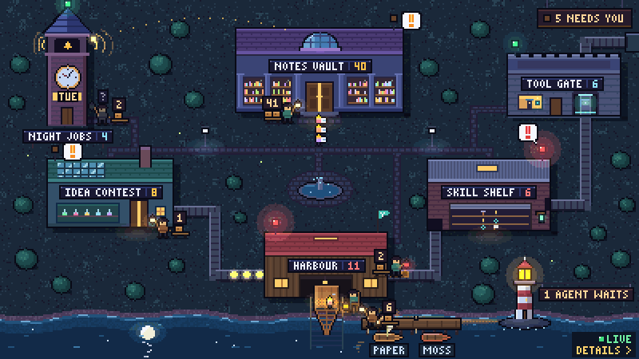
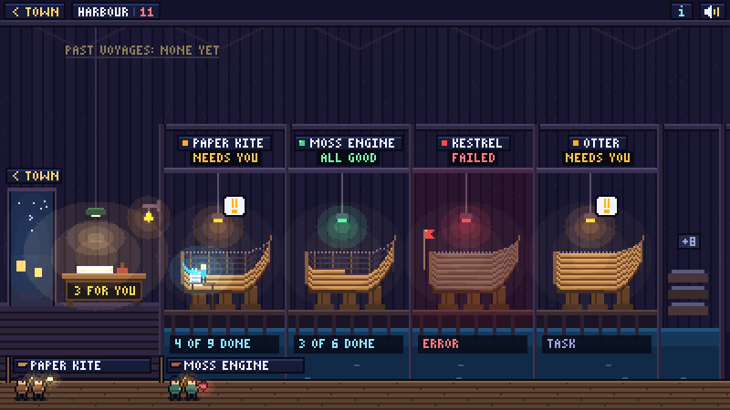
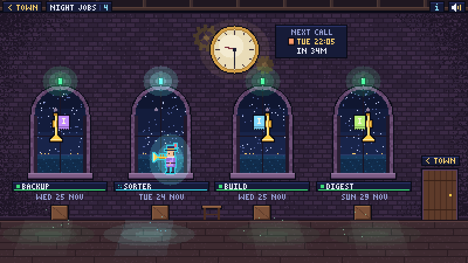
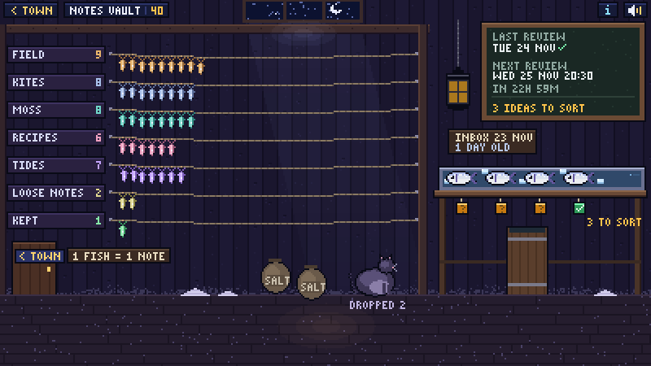
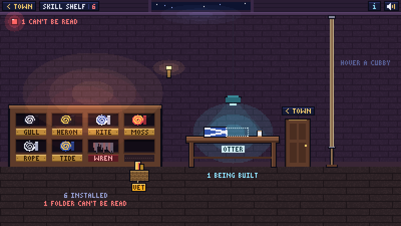
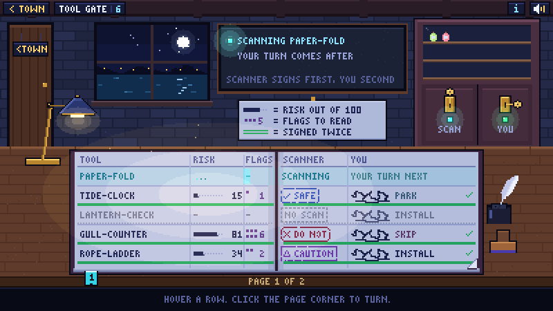
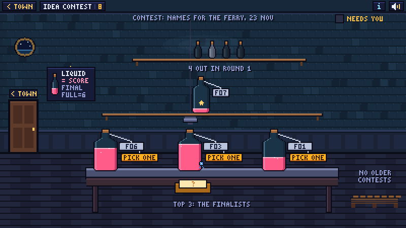
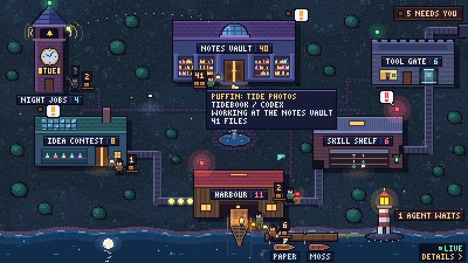

<p align="center">
  
</p>

# Lamptown

**A pixel-art town whose lamps show what your AI agents are doing, and when one needs you.**

Each building in the town stands for one part of your setup: agents and projects, scheduled jobs,
notes, installed skills, tools waiting to be vetted, an idea contest. Its lamp shows the live state,
and you can walk inside every building to see the details. Everything that moves stands for real
data, so a quiet setup gives a still town.

Lamptown runs on your own machine, reads local files only, and works with any agent that can write
a small JSON file.

## Quick start (60 seconds)

```sh
pipx install lamptown
lamptown demo
```

`lamptown demo` builds a made-up town (nine agents, three projects, four jobs, a notes vault, a
skill shelf, a tool gate and a contest), opens it in your browser and keeps it live until
Ctrl+C: the agents walk the town and the lighthouse keeps a week of their history. Nothing is
read from your machine.

<!-- CHECK: `pipx install lamptown` works once the first release is on PyPI. -->
Before the first release reaches PyPI, install from a checkout of this repository:

```sh
python -m venv .venv
.venv/bin/pip install .          # Windows: .venv\Scripts\pip install .
.venv/bin/lamptown demo          # Windows: .venv\Scripts\lamptown demo
```

Lamptown needs Python 3.11 or newer. The core uses the standard library only.

Try `lamptown demo --state waiting` (or `ok`, `working`, `error`, `missing`) to see every building
in one state.

## How it works

```text
your files            collectors             room data            the town
---------------       ----------------       ---------------      --------------------
status files    -->   status_dir       -->   JSON per building -> town.html
logs, notes,          log_glob, ...          (checked against     (one self-contained
TASKS.md, scans       or your own            a schema)            page, no server)
```

1. **Sources.** `lamptown.toml` lists your buildings and what each one reads: a folder of status
   files, a log glob, a notes folder, a list of projects.
2. **Collectors.** Each source runs a small, read-only collector that turns those files into room
   data. A collector that crashes or takes over 10 seconds turns only its own building red.
3. **Town.** `lamptown build` writes one self-contained `town.html`, plus `town-details.html`: the
   same data as plain, accessible text. Open it in a browser, or in the desktop app, which keeps it
   live.

Every building has a lamp:

| Lamp | State | Means |
|---|---|---|
| green | `ok` | running fine |
| green, and the building moves | `working` | running now (cyan inside the rooms) |
| amber, with a "!" | `waiting` | needs you; counted on the "N NEEDS YOU" sign |
| red | `error` | something is wrong: it failed, missed its run, or stopped responding |
| grey | `missing` | can't see it: the source isn't there yet |

When one building has several sources, the worst state wins:
`error > waiting > working > missing > ok`.

## The six rooms

The v1 town has six fixed plots, one per built-in room type. Each one can be relabelled, fed from
any source, turned off (it becomes an empty lot) or taken over by a room you write.

<table>
<tr>
<td width="50%"><br>
<b>Harbour</b> (<code>harbour</code>): one berth per project or agent. A hull is planked by the
ticked boxes in the project's <code>TASKS.md</code>; what waits on you sits on the harbourmaster's
desk. Reads project folders and agent status files.</td>
<td width="50%"><br>
<b>Clock tower</b> (<code>jobs</code>): one window and one trumpet per scheduled job, with its next
run on the clock. A missed run shows as a red lantern. Reads job logs and status files.</td>
</tr>
<tr>
<td><br>
<b>Salt house</b> (<code>vault</code>): a Markdown notes folder. One drying line per folder, one
salted fish per note, and an inbox tray of ideas to sort. Reads a notes folder.</td>
<td><br>
<b>Flag locker</b> (<code>shelf</code>): the skills, plugins or tools your agents have installed,
one signal flag each, plus the ones still being built. Reads skill folders.</td>
</tr>
<tr>
<td><br>
<b>Vetting gate</b> (<code>ledger</code>): every new tool needs two signatures, a security
scanner's verdict and your own call. Reads scan reports and a decisions file.</td>
<td><br>
<b>Idea contest</b> (<code>contest</code>): a blind trial of ideas as sealed, coded bottles filled
by score, and your pick under a warm lamp. Reads <code>contest.json</code> files.</td>
</tr>
</table>

What each room shows for each state, its data contract and how far it scales:
[docs/rooms.md](docs/rooms.md).

## Connect your agent

Agents report through **`agent-status/1`**: one small JSON file per agent or task, in
`~/.agent-status/` (or `$AGENT_STATUS_DIR`). The format is open and documented in
[spec/agent-status-1.md](spec/agent-status-1.md), so any tool can write it.

| Agent | How | Guide |
|---|---|---|
| Claude Code | hooks in `settings.json` run `lamptown status hook claude-code` | [docs/adapters/claude-code.md](docs/adapters/claude-code.md) |
| Codex CLI | `notify` (and optional hooks) in `~/.codex/config.toml` | [docs/adapters/codex.md](docs/adapters/codex.md) |
| Gemini CLI | hooks in `settings.json` | [docs/adapters/gemini-cli.md](docs/adapters/gemini-cli.md) |
| Cursor | `hooks.json` | [docs/adapters/cursor.md](docs/adapters/cursor.md) |
| Anything else | wrap the command | [docs/adapters/wrapper.md](docs/adapters/wrapper.md) |

For Codex, it is one line in `~/.codex/config.toml`:

```toml
notify = ["lamptown", "status", "hook", "codex"]
```

For a tool with no hooks, a script or a cron job, put the wrapper in front of it. The lamp is
`working` while it runs, then `ok` or `error` with the last lines of stderr:

```sh
lamptown status run --id nightly-backup --title "Nightly backup" --kind job -- ./backup.sh
```

From your own scripts, set a lamp directly:

```sh
lamptown status set paper-kite --title "Paper Kite" --state working --progress 3/8
lamptown status set paper-kite --need "Approve the plan"      # turns the lamp amber
lamptown status list
```

Or in Python, with `from lamptown.status import agent_status`. Ready-to-paste configs for every
agent are in [examples/](examples/), and `lamptown init --hooks claude-code` (or `codex`,
`gemini-cli`, `cursor`) prints the one you need. More in [docs/status.md](docs/status.md).

Then let a building read the status folder. In `lamptown.toml`:

```toml
version = 1

[[building]]
id = "harbour"
label = "Agents"
  [[building.source]]
  kind = "status_dir"
  dir = "~/.agent-status"
```

## The live town

<p align="center">
  
</p>

Add a `[live]` table to `lamptown.toml` and run `lamptown watch` (or the desktop app), and your
agents walk the town as they work. Each one is a **Lamplighter** with a lantern, at the building
it works in: working, sitting by the door when it needs you, stepping aside with a red lantern
when it failed. The **lighthouse** sweeps its beam while anyone works and flashes when an agent
starts waiting, then lights the path to that door. Each project at the harbour gets a **berth**,
and inside the lighthouse the keeper's book keeps the last 7 days.

```toml
[live]

[[live.reader]]
kind = "claude_code"   # follows Claude Code's own session files: no hooks needed

[[live.reader]]
kind = "codex"         # and Codex's rollout logs
```

Only names leave your files: titles, project folder names, tools, states and counts. The whole
story, every key and the troubleshooting table: [docs/live.md](docs/live.md).

## Your own town

```sh
lamptown init --user    # write a starter lamptown.toml where Lamptown looks for it
lamptown doctor         # check the config, every source, the status folder, the app and a browser
lamptown open           # build the town and open it in your browser
```

`lamptown init` asks no questions. It checks only whether `~/.claude`, `~/.codex`, `~/.gemini` and
`~/.cursor` exist (it never reads inside them) and writes a starter town: an "Agents" boathouse and
a "Scheduled jobs" clock tower that read your status folder, plus a skill shelf when it finds a
skills folder. Without `--user` it writes `lamptown.toml` in the current folder; then pass
`--config lamptown.toml` to the other commands.

`lamptown doctor` prints one `ok`, `warn` or `FAIL` line per check, with a `fix:` line under each
problem. It changes nothing.

Edit the config to add buildings and sources; every key is in [docs/config.md](docs/config.md).
The per-user config folder is `%APPDATA%\lamptown\` on Windows,
`~/Library/Application Support/lamptown/` on macOS and `~/.config/lamptown/` on Linux. You can
also point `--config` or `$LAMPTOWN_CONFIG` at any file.

## Desktop app

The desktop app shows the town in its own window and keeps it live: it rebuilds every 15 seconds
while the window shows and swaps in only what changed. With `[live]` on it runs the Watcher
itself, and its window title counts what needs you ("2 need you - Lamptown"). While it is
minimised it stops rebuilding and drawing, and catches up the moment you bring it back.

```sh
pipx install "lamptown[app]"
lamptown app
lamptown shortcut
```

`lamptown shortcut` adds a launcher the native way on each OS:

| OS | Shortcut | Window |
|---|---|---|
| Windows | a `.lnk` on the desktop | WebView2, the Edge web view that comes with Windows |
| macOS | `Lamptown.app` in `~/Applications` | WKWebView (built in) |
| Linux | `lamptown.desktop` in your app menu | WebKitGTK or Qt: `pip install "pywebview[gtk]"` (with your system's WebKitGTK and PyGObject) or `pip install "pywebview[qt]"` |

Starting it a second time brings the open window to the front. Without the `[app]` extra,
`lamptown app` opens the town in your browser instead and says what to install.

## Commands

| Command | Does |
|---|---|
| `lamptown demo [--state STATE] [--no-open] [--no-live] [--out DIR]` | Build the fictional demo town, open it and keep it live (Ctrl+C stops). |
| `lamptown build [--config FILE] [--out DIR] [--now ISO] [-q]` | Run every source and write `town.html` and `town-details.html`. |
| `lamptown open [--config FILE] [--out DIR] [--watch]` | Build, then open the town in your browser (`--watch`: then keep it live). |
| `lamptown watch [--config FILE] [--out DIR] [--every SECONDS]` | Keep the town live: the Watcher every few seconds, a rebuild every 15 s ([docs/live.md](docs/live.md)). |
| `lamptown app [--config FILE] [--poll SECONDS]` | The town in its own window, kept live. |
| `lamptown shortcut [--dir DIR] [--config FILE] [--name NAME]` | A desktop shortcut or app-menu entry for the app. |
| `lamptown status set \| run \| hook \| list` | Write and read `agent-status/1` files ([docs/status.md](docs/status.md)). |
| `lamptown init [--user \| --dir DIR] [--hooks AGENT]` | Write a starter config, or print one agent's hook block. |
| `lamptown doctor [--config FILE] [--strict]` | Check your setup and say how to fix each problem. |

Every command has `--help`. `lamptown build` exits with 2 when the config is wrong (one line says
which key and why) and 3 when it can't write the town.

## Make it yours

- **Configuration**: every key, path rule and schedule format: [docs/config.md](docs/config.md).
- **Write a collector** for any data source: one Python function, `collect(paths, now) -> dict`.
  Point a source at `collector = "./mine.py"`, or publish it as a package under the
  `lamptown.collectors` entry point: [docs/collectors.md](docs/collectors.md).
- **Write a room**: one script that calls `registerRoom` and draws with the shared pixel kit `K`.
  Load it with `room_js = "./mine.js"` or the `lamptown.rooms` entry point:
  [docs/rooms.md](docs/rooms.md#bring-your-own-room) and [docs/kit-k.md](docs/kit-k.md).

All the docs: [docs/index.md](docs/index.md).

## Privacy

Lamptown is built to sit on top of private work, so it is careful by design:

- **Local files only.** Collectors read the files and folders you list, read-only. They never
  write, move or delete anything in a source.
- **No network, no telemetry.** Lamptown sends nothing anywhere. The town page loads no outside
  scripts, fonts or images. The desktop app talks only to itself, on `127.0.0.1` with a random
  token, so a second launch can bring the first window to the front. (The one exception is
  opt-in: the `ci_gh` live reader asks GitHub, through your `gh`, for a pushed project's CI
  result.)
- **Private projects stay closed.** A project marked `private = true`, or inside a folder listed in
  `private_dirs`, is never opened, listed or read; only whether its folder exists is checked.
- **Hooks keep secrets out.** A status file written by a hook holds the lamp state, a fixed
  message ("Working", "Turn finished", a tool's name), the project folder's name and path, and
  the start of the session id. Never your prompts, the agent's replies, tool input, file contents
  or account details. Reply excerpts are opt-in (`--excerpts`): one short line, secrets masked.
- **Private agents too.** A `status_dir` source with `private = true`, or with `private_dirs`,
  shows those sessions as "Private agent": no name, message or links.
- **The live town keeps names only.** Its readers read Claude Code's, Codex's and git's own
  files read-only, and keep a title, a project folder's name, a tool, a state, times and
  counts. Never prompts, replies, file contents, paths, commit messages or author names
  ([docs/live.md](docs/live.md#what-it-reads-and-what-it-keeps)).
- **Links are filtered.** Only `https:`, `http:` and `file:` links reach the page, and all data is
  escaped before it is inlined. In the desktop app a `file:` link never runs anything: it shows
  the file in its folder; links to network shares are refused.

What Lamptown writes, and where, is listed in [SECURITY.md](SECURITY.md).

## Contributing

Bug reports, rooms, collectors and adapters are welcome. Start with
[CONTRIBUTING.md](CONTRIBUTING.md): dev setup, tests, the privacy gate and the house style.
Everyone taking part follows the [Code of Conduct](CODE_OF_CONDUCT.md). Report a security problem
privately, as [SECURITY.md](SECURITY.md) explains.

## Licence

MIT. See [LICENSE](LICENSE). All art in Lamptown is drawn in code.
