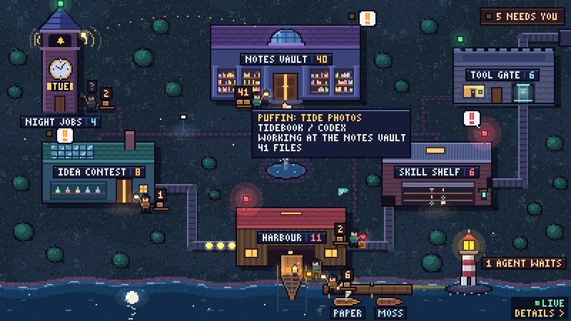

# The live town



With a `[live]` table in `lamptown.toml`, the town shows your agents as they work. Each agent is a
small figure carrying a lantern, a **Lamplighter**, standing at the building it works in. A
**lighthouse** in the bay sweeps its beam while anyone works, and flashes when an agent needs you.
Each project with an agent at the harbour gets a **berth**: a boat moored at the wharf. Inside the
lighthouse, the keeper's book keeps the last 7 days.

`lamptown demo` shows all of it with made-up agents, and needs nothing from your machine.

## Switch it on

Add a `[live]` table. It needs no keys:

```toml
[live]

[[live.reader]]
kind = "claude_code"     # read Claude Code's own session files (no hooks needed)

[[live.reader]]
kind = "codex"           # read Codex's rollout logs (no hooks needed)
```

Then keep the town live:

```sh
lamptown watch           # keep the files next to town.html up to date; Ctrl+C stops
lamptown open --watch    # build, open the town in your browser, then the same
lamptown app             # or the desktop app, which keeps its window live by itself
```

Every key is in [config.md](config.md#live).

## `lamptown watch`

Runs the **Watcher** every few seconds and rebuilds the town every 15 s. It writes these files
next to `town.html`, and an open town page picks them up by itself:

| File | What | Written |
|---|---|---|
| `town-live.js` | the agents now (`lamptown-live/1`) | every Watcher run, and at least every 10 s: the page's heartbeat |
| `town-data.js` | the town's data, with its `rev` | with each rebuild, always before the `town-live.js` that names its `rev`: the page loads it only when the `rev` changed |
| `town-history.js` | the lighthouse's book (`lamptown-history/1`) | with each rebuild, and at most once a minute between them |

| Flag | Default | Meaning |
|---|---|---|
| `--config FILE` | `$LAMPTOWN_CONFIG`, then the per-user config | The `lamptown.toml` to use. |
| `--out DIR` | `[town] out`, then the per-user data folder | Where `town.html` is. |
| `--every SECONDS` | `[live] poll` (3) | Seconds between Watcher runs, 0.2 to 3600. |
| `--rebuild SECONDS` | 15 | Seconds between full rebuilds, 0.2 to 3600. |
| `-q`, `--quiet` | off | Print nothing but errors. |

`lamptown open --watch` takes the same `--every` and `--rebuild` (they only work together with
`--watch`). `--now` can't be used with `--watch`: a live town keeps the real time.

Exit codes: 0 after Ctrl+C, 2 when the config is wrong or has no `[live]` table (or live was
switched off while it ran), 3 when the first build can't be written.

**One Watcher per status folder.** The Watcher takes a lock in `<status folder>/.lamptown/`. A
second one (the app and `lamptown watch` at once, say) says so, stands by, and takes over from the
saved state when the first stops. Either one keeps the page live.

## What it reads, and what it keeps

The Watcher reads, read-only:

- **The status folder** (`agent-status/1` files, written by the hooks, `lamptown status set` and
  `lamptown status run`): `[live] status_dir`, else the first `status_dir` source's folder, else
  `$AGENT_STATUS_DIR`, else `~/.agent-status`. See [status.md](status.md).
- **Readers**, one `[[live.reader]]` each. They follow a tool's own files, so no hook is needed:

| `kind` | Reads | Options |
|---|---|---|
| `claude_code` | `~/.claude/sessions/` and the session logs under `~/.claude/projects/` | `root`, `on_stop`, `days`, `titles` ([status.md](status.md#reading-claude-codes-own-files-no-hooks)) |
| `codex` | `~/.codex/sessions/YYYY/MM/DD/rollout-*.jsonl` and the titles in `~/.codex/state_5.sqlite` | `root` (else `$CODEX_HOME`, else `~/.codex`), `days` |
| `git` | the reflogs of a repository (`.git/logs/`): commits and pushes, with no `git` process | `repos`, `status_dir`, `days` |

  The `git` reader counts commits and pushes on the agent working in that repository when you
  give it the status folder too (`status_dir = "~/.agent-status"`: it does not take the live
  one by itself). A reader of your own is `reader = "./my_reader.py"` or a package registering a
  `lamptown.readers` entry point; the contract is in `src/lamptown/status/readers/__init__.py`.

What it writes: the status files (one per agent, the same ids the hooks use, so a hook and a
reader share one record), and one event log line per thing that happened, in
`<status folder>/events/YYYY-MM-DD.jsonl` (one file per local day; times in UTC).

**Names only.** What reaches the page, the event log and the book is a title, a project folder's
*name*, a tool's name, a state, a time and counts (files changed, commits, pushes, CI). Never
message text, prompts, replies, tool input, file contents, file paths, commit messages or
author names. A changed file is counted by a salted hash, kept only in the Watcher's saved state.
Claude Code's session title is written by Claude Code from your first message, so it can carry
your words: `titles = "folder"` on that reader names sessions by their project folder instead.

**Private folders.** An agent working in or under a folder in `[live] private_dirs` (or a
`status_dir` source's `private_dirs`) shows as "Private agent": no name, no project, no berth, a
hashed id. An agent started in your home folder or at a drive root has no project name (the
folder's name there would be your login name).

## How each state reads in town

| State | The Lamplighter | The lighthouse |
|---|---|---|
| `working` | stands at its building with a warm, steady lantern | the beam sweeps slowly over the water |
| `waiting` | sits on the chair by the door, its lantern set down on the step; it slumps the longer it waits | a new wait flashes the lantern and rings its bell once; then a steady amber beam holds on the landing, and its light runs up the footpaths to the door that needs you |
| `error` (failed, or working but silent past `stale_after`) | steps aside onto the path, its lantern red and lowered | the same in red (a flash, no bell) |
| quiet (working, silent past `quiet_after`, 6 h by default) | stands with a dark lantern and a grey "?" | nothing: a quiet agent is no longer an alert |
| `ok` (done) | is gone; its lantern hangs on the hook by the door for 15 minutes | nothing |

- **Where an agent stands.** The reader's own choice (`x-plot`), else the clock tower for
  scheduled jobs, else the building whose sources hold its working folder (the most specific
  folder wins; a `[[live.place]]` wins a tie), else the harbour. See [config.md](config.md#live).
- **Helpers.** Subagents follow their agent as smaller figures. A waiting, failed or quiet helper
  always walks with it; working helpers past two are counted on its card.
- **Carts.** An agent's changed files ride a cart behind it, with one count on it.
- **Cards.** Hover a Lamplighter to see its card (title, project and tool, state, counts). Click
  it to pin the card; click anywhere else (or press Escape) to let it go.
- **Crowds.** At most 12 figures are drawn; an agent waiting for you or failed is never left out.
  Each building's figures not drawn are one "+N" tag.
- **The sign.** The lighthouse's sign counts the waits ("2 AGENTS WAIT"), and the town's
  "N NEEDS YOU" sign counts them with every other need.
- **Berths.** One boat per project with an agent at the harbour (a project with no agents at all
  gets one too; a project whose agents all work elsewhere gets none). Its agents stand on the
  wharf at its berth. A pushed project's boat has its sail up; a CI pennant flies amber, green or
  red. A new project's boat is launched down the slipway once. Six berths at most; the rest share
  one mooring tagged "+N", and move up when a berth frees.

Everything that moves is a real change: a town where nothing changes is still. There are no
pop-up notices.

## LIVE, or not

The corner of the town says **LIVE** while the page has a fresh heartbeat: a `town-live.js` (or
the app's own push) whose time is under **30 seconds** old. Then it shows the Lamplighters, the
lighthouse's light and the berths. Without one (no Watcher running, or it stopped) the corner
says **BUILT** and the time of the build, and the live town is hidden: an old payload never
pretends to be news. The lighthouse stands dim.

The page reads `town-live.js` every 5 s while it shows (every 30 s after three misses in a row,
and back to 5 s when one loads). `town.html?live=0` stops the polling.

## The keeper's book (7 days)

Click the lighthouse to go in. The keeper's book has a tab per day, today last: one line per
agent, in the order they came in, with what happened written as it happened (IN, PUSHED, CI GREEN,
WAITING, DONE, FAILED, QUIET). The brass clock replays a day in about a minute. The closing slip
says what is still open, most urgent first. The keys are in
[rooms.md](rooms.md#lighthouse-the-keepers-book).

`[live] history_days` sets how many days (1 to 31, 7 by default). The Watcher removes event
files older than that.

## The desktop app

`lamptown app` runs the same Watcher inside the app. It pushes each payload straight into the page
(no file needed), and its window title counts what needs you: "1 needs you - Lamptown",
"2 need you - Lamptown". Its corner says **LIVE** while its Watcher feeds the page; without
`[live]` (or when the Watcher has stalled) it says "LIVE - UPDATED" and the time of the app's last
build. While the window is
minimised it only runs the Watcher now and then (so the book keeps filling and the title still
counts), and catches up the moment you bring it back.

## Performance

| What | Budget |
|---|---|
| One Watcher run | reads at most 2 MB in all and 512 KB per file (new lines only: every log is tailed from where it left off) |
| Catching up (first run, or after a long pause) | up to 32 MB a run, 4 MB per file, within 200 ms of reading; it then runs every second until no reader is behind, then back to `poll` |
| The page | one small script load every 5 s (none while the tab is hidden); nothing moves unless the payload changed |
| The payload | at most 200 agents and 60 projects; the rest is one count (`more`) |
| The book | at most 300 agents and 4000 events a day |

A reader catching up reads live sessions first, and history behind them. A log not changed in
`days` (7 by default) is never opened.

## Upgrading from 0.1

Codex record ids changed: they are now `codex-` and the last 12 hex digits of the thread id (0.1
used its first 12 characters, which are a clock: parallel sessions could share them). The hooks
and the Codex reader agree on the new ids, and the reader's saved state moves to them by itself.
A status file a 0.1 Codex hook wrote keeps its old id, so it goes stale once: it ages out like
any silent file ("Stopped responding", then gone quiet, then left out after 7 days).
`lamptown status clear --older-than 1d` tidies it away sooner.

## Troubleshooting

| You see | Why, and what to do |
|---|---|
| The corner says BUILT, no Lamplighters | No Watcher is writing `town-live.js`, or it stopped. Run `lamptown watch` (or the app) with the same `--config` and `--out` as the build. |
| `lamptown watch` says live is off | The config has no `[live]` table, or `enabled = false`. |
| "another Lamptown watcher is running on this status folder" | The app or another `lamptown watch` holds the folder. This one stands by; either keeps the page live. |
| "live reader 'x' can't start" | The `kind` is unknown (the built-ins are `claude_code`, `codex` and `git`) or a reader file failed to load. The other readers still run. |
| An agent shows in the wrong building | Add a `[[live.place]]` with its folder and the plot it should walk to. |
| An agent has no berth | Its agents all work at another building, or it is private, or it started in your home folder. |
| A Codex session shows twice after upgrading | The old one is a 0.1 hook's file; see [Upgrading from 0.1](#upgrading-from-01). |
| A waiting Claude Code session reads as working | Without hooks, a Bash or MCP tool waiting for permission looks the same as a long one. Install the [Claude Code hook](adapters/claude-code.md) too: the reader and the hook share one record. |
| The figures stand still and the corner says LIVE | Nothing changed: the live town moves only when an agent does. |
