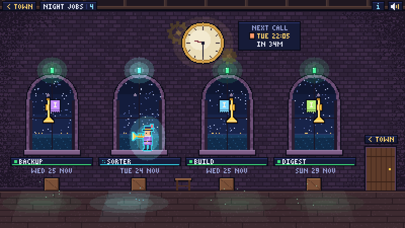
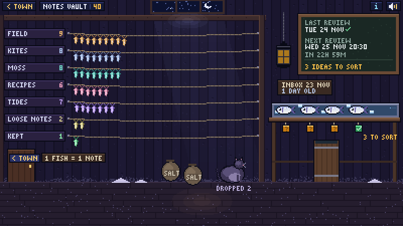
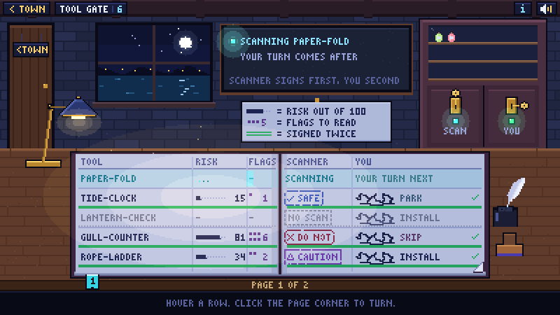
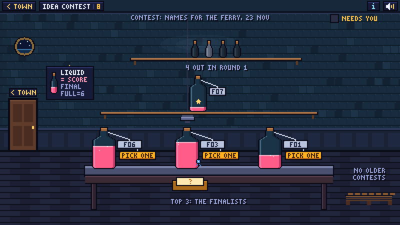
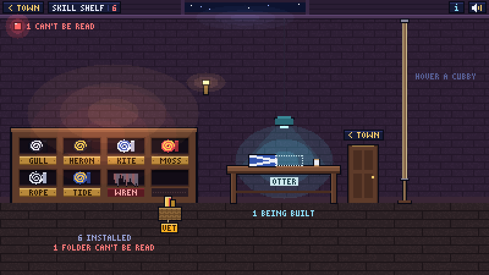
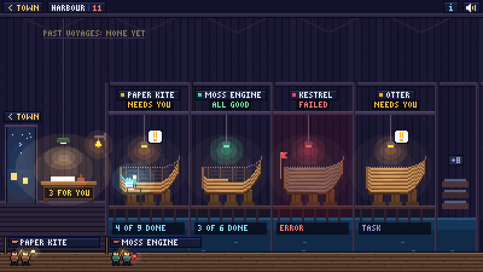

# Rooms

Every building in the town opens into a room. Click a building (or Tab to it and press Enter), and
the camera walks in through its door. Escape, or `< TOWN` in the corner, walks you back out.

A room is one script, drawn in code on the same 400 × 225 pixel canvas as the town. It gets the
building's **room data**, the JSON its collectors produced, and draws it. The rule for every room:
**everything that moves stands for real data.** A quiet setup gives a still room.

This page has two halves: the six built-in rooms (what data they read, what each state looks like,
how far they scale), and [how to bring your own room](#bring-your-own-room).

## The five states

Every room, row and lamp uses the same five words. Worst first, when states are merged:
`error > waiting > working > missing > ok`.

| State | Town lamp | In a room | Plate words |
|---|---|---|---|
| `ok` | green | green | running fine |
| `working` | green, and the building moves | cyan | running now |
| `waiting` | amber, with a "!" bubble | amber | needs you |
| `error` | red | red | something is wrong |
| `missing` | grey | dark grey, "-" | can't see it |

`waiting` items also count towards the town's "N NEEDS YOU" sign. A room whose data could not be
read at all shows a red notice saying why, and the plate shows "!".

## The data every room gets

All six schemas share these top-level keys. Only `state` is required.

| Key | Type | Meaning |
|---|---|---|
| `state` | one of the five states | The room's state, and the building's lamp. |
| `label` | string | A few words for the lamp's tooltip ("2 jobs late"). |
| `error` | string | The short reason, when `state` is `error`. |
| `num` | string or integer | The number on the building's name plate. Each room has a sensible default. |
| `updated` | ISO time | The newest change the sources know of. |
| `needs` | list of `{text, href?}` | Things a person must do. Links keep only `https:`, `http:` and `file:`. |
| `rows` | list of objects | One row per job, project, tool or item (the row-based rooms). |

All times are absolute ISO 8601 strings with an offset. The page writes "in 3 h" itself, so the
clock alone never changes the data. The schemas are in
[`src/lamptown/schemas/rooms/`](../src/lamptown/schemas/rooms/); data that doesn't fit its schema
turns the room red with the first problem as the reason.

## Try any room with sample data

Every built-in room has a demo mode with fictional sample data. Open your built `town.html` with:

```text
town.html?room=<building id>&demo=1&state=waiting
```

In demo mode the number keys `1` to `5` (or `6`) switch the state. `?motion=1` animates even when
your system asks for reduced motion. Other town parameters: `?t=<seconds>` freezes the animation
at that moment, and `?at=<ISO time>` pretends the clock says that time (both are for screenshots
and tests).

## The six built-in rooms

### `jobs`: the clock tower



One arched window and one trumpet per scheduled job. The clock shows the real time, and the plaque
under it names the next call. Click a window and the trumpeter climbs up and plays that job's last
result. Click a slate to open the job's log.

**Data.** `rows`, one per job:

| Field | Meaning |
|---|---|
| `name`, `state` | Required. |
| `id`, `short` | A stable id, and the slate name (upper case in the pixel font). |
| `schedule`, `when`, `when_short` | The schedule as written, in plain words ("Tuesdays 07:15"), and for the chalk slate ("EVERY TUE 07:15"). |
| `next`, `last` | When it runs next, and when it last ran (ISO times). |
| `result` | What the last run said. |
| `why` | Which case of the state: `missed`, `stopped`, `failed`, `running`, `never`, `nosource`, `unreadable`. |
| `href` | The log, or another link. |
| `feeds` | A building id this job feeds; a spark flies there while it runs. |
| `colour` | `"#rrggbb"` for the job's banner. |

**States.**

| State | You see |
|---|---|
| `ok` | An open window on a night sea, the trumpet on its hook. The call plays in full. |
| `waiting` | The same, with a "!" bubble. The call ends on a question. |
| `working` | The trumpeter stands at that window playing soft notes. The town's bell rings. |
| `error` | A dented trumpet on the floor among torn music. A missed run: the trumpet on its hook under a red lantern. |
| `missing` | Boarded shutters, a cobweb, an empty hook. |

**Scale.** One or two jobs get two big arches with chalk slates. Three to eight get a row of
narrower windows. Past eight, a chalk board reads "+N MORE" and its tooltip lists the rest, worst
first.

**Sources.** [`log_glob`](config.md#log_glob) (one source per job) and
[`status_dir`](config.md#status_dir) (status files with `kind = "job"`).
Demo: `&state=ok|waiting|working|error|missing|missed`, `&jobs=1..12`.

### `vault`: the salt house



A notes vault as a salt house. Each folder is a drying line, and each note is a salted fish on it.
The newest inbox note is the wet tray by the window, one fresh fish per idea. A cat by the barrel
eats the ideas you drop.

**Data.**

| Key | Meaning |
|---|---|
| `folders` | `[{label, n, key?, href?, notes?, kept?}]`: one line per folder, `n` notes (the true count; `notes` holds some names). |
| `notes` | The total number of notes. |
| `inbox` | `{items, untriaged, date, file, href, total, kept, drops, unreadable}`. Each item is `{title, from?, href?, triaged, mark: "keep" \| "drop" \| null}`. |
| `last_review`, `next_review` | ISO times. `review_when` says the schedule in words. |
| `dropped` | `{n, names, href}`: the dropped notes, which feed the cat. |
| `kept` | How many kept notes there are. |
| `why` | `missed`, `running`, `never`, `nosource`, `inbox`. |
| `vault_name` | The vault folder's own name (never its full path). |

**States.**

| State | You see |
|---|---|
| `ok` | Every idea is sorted. A green lantern by the slate. |
| `waiting` | Ideas on the wet tray with amber "?" tags. The tray ages: the ice melts and flies gather. |
| `working` | A review is filing notes now. The brine barrel bubbles under a cyan lantern. |
| `error` | The review missed its run. Red chalk across the slate. |
| `missing` | No review on record yet; or no vault at all: empty pegs, no cat, an empty basket. |

**Scale.** A line holds about 32 fish. Past that, every line ties its fish into bundles of 5, 10,
20 and so on (one unit for the whole wall, so lines still compare), and a sign says so. Up to seven
lines; more folders fold into one "+N MORE" line. The tray shows five ideas, then "+N".

**Sources.** [`markdown_vault`](config.md#markdown_vault).
Demo: `&state=...`, `&age=N` days, `&ideas=1..12`, `&scale=N`, `&folders=N`.

### `ledger`: the vetting gate



A clerk's desk and an open ledger: the two-signature register for tools on their way in. Each row
needs the scanner's stamp (its verdict, risk and flags) and your signature (install, skip or park).
Both in, and the row is ruled closed in green. The cupboard behind holds one bottle per installed
item and is locked twice: SCAN and YOU.

**Data.** `rows`, one per tool, newest first:

| Field | Meaning |
|---|---|
| `tool`, `state` | Required. |
| `kind` | `signed`, `waiting`, `scanning`, `noscan`, `unreadable`, `skipped-in`, or one of the grey kinds `homemade`, `norecord`, `unscanned`. |
| `scan` | `{verdict, risk, flags, when}` or `null`. `risk` is 0 to 100; `flags` a count or a list. |
| `decision` | `{call: "install" \| "skip" \| "park", date, note, source}` or `null`. |
| `installed`, `origin` | Whether it is installed; `own` or `third-party`. |
| `result`, `href`, `when` | A line of text, a link, and when the row last changed. |

**States.**

| State | You see |
|---|---|
| `ok` | Green double rules, both keys turned. |
| `waiting` | An amber "WAITS FOR YOU" box in the row. Its bottle waits on the desk and the YOU lock is shut. |
| `working` | A cyan sweep along the row being scanned. The SCAN key jiggles. |
| `error` | The row glows red with "!". The SCAN lock is forced and its bottle has a red tag. |
| `missing` | No scans: the lamp is off, the ledger is blank, the locks have no keys. |

Grey rows (home-made with no scan, scanned with no recorded call) never raise the room's state.

**Scale.** Five rows a page, with a page count and up to eight bookmarks for pages that need you
(click the page corner, or use the arrow keys, to turn). 24 bottles in the cupboard, then "+N";
two bottles waiting on the desk, then "+N".

**Sources.** [`scan_glob`](config.md#scan_glob).
Demo: `&state=ok|waiting|working|error|missing|norecord`, `&rows=N`, `&page=N`.

### `contest`: the blind trial



An idea contest run blind. Every entry is an identical sealed bottle with only a code on it. The
liquid is its score. The judges' winner is the fullest bottle and wears a blue rosette. **Your pick
is a separate thing**: the warm lamp in the room and the trophy in the town.

**Data.**

| Key | Meaning |
|---|---|
| `entries` | The newest contest's entries, best first: `{code, name?, sealed, fill}`. `fill` is 0 to 1. A `name` appears only once the entry is unsealed. |
| `judges` | `{expected, received}`. |
| `winner` | The judges' first place: a code while sealed, else its name. |
| `pick` | Your pick's name, `"None picked"`, or `null`. |
| `title`, `count` | The newest contest's title, and how many contests there are. |
| `contests` | Every contest, newest first, with its cards, for the bench and the crates. |

**States.**

| State | You see |
|---|---|
| `ok` | The pick's tag turns round to show its name under the warm lamp. |
| `waiting` | Step "unblind": an amber sealed envelope, "UNBLIND?". Step "pick": amber "PICK ONE" tags on the finalists. |
| `working` | The judges' lamps drip until each judge is in: "1 OF 3 DONE". Bubbles rise in the town. |
| `error` | A red notice says which file, and which code it names that is not an entry. |
| `missing` | Empty, dusty shelves; the lamp is off. |

Unblinding in the room is remembered on that screen only. Nothing is written.

**Scale.** The top shelf holds 24 vials, then "+N"; the middle shelf five tagged bottles or 15 small
ones, then "+N"; the bench four finalists; six crates of older contests, then "+N".

**Sources.** [`contest_json`](config.md#contest_json); the
file format is in [contest-format.md](contest-format.md).
Demo: `&state=ok|waiting|pick|working|error|missing`, `&entries=N`, `&contest=N`.

### `shelf`: the flag locker



The skills, plugins or tools your agents have installed, as a locker of rolled signal flags. Each
flag's pattern comes from a hash of the item's name, in real signal-flag colours. It is identity
only, never a status. Hover a cubby and its flag runs up the halyard and unfurls with a tag that
says what the item does.

**Data.** `rows`, one per item:

| Field | Meaning |
|---|---|
| `name`, `state` | Required. |
| `stage` | `installed` (ok), `staged` (waiting), `building` (working), `broken` (error). |
| `short` | The brass plate (about 7 letters fit). |
| `line` | One plain sentence about what it does. |
| `href` | Its manifest, or its folder. |

**States.**

| State | You see |
|---|---|
| `ok` | A rolled flag in a cubby above a brass plate. |
| `waiting` | A staged item waits rolled in a basket under an empty cubby, with an amber VET tag. |
| `working` | A half-sewn flag on the bench under the cyan work lamp. |
| `error` | A torn scrap over a red plate. |
| `missing` | The locker is padlocked and dark. |

Bundles another app syncs in sit in the sea chest by the mast, with their count on its plate.

**Scale.** Four columns up to 16 cubbies, six up to 30, then eight; six rows at most, so 48
cubbies. Past that, the last cubby reads "+N MORE". One basket per column, five items on the bench,
then "+N".

**Sources.** [`skill_dirs` and `staging_dir`](config.md#skill_dirs-and-staging_dir).
Demo: `&state=...`, `&items=1..80`.

### `harbour`: the boathouse



Your projects and agents, one berth each. An active project is a hull on its slip, planked by the
ticked boxes in its `TASKS.md`. Items waiting on you are sheets on the harbourmaster's desk by the
door; hover the desk and the bell rings. Paused projects are moored under a tarp. Closed ones are
framed boards on the "past voyages" wall.

**Data.** `rows`, one per project or agent:

| Field | Meaning |
|---|---|
| `name`, `state` | Required. |
| `status` | `active`, `paused` (or `parked`), `closed` (or `done`, `archived`). Rows without one are agent berths and count as active. |
| `progress` | `{done, total}`: the planks. |
| `needs`, `needs_n` | Items waiting on you (a list, or a count). `agent_items`, `agent_n`: the agent's own items, a pale note on the hull. |
| `busy` | Someone is at work on it right now. |
| `message` | What the agent says now (from its status file). |
| `updated`, `last_commit` | ISO time; `{when, msg}` of the newest commit. |
| `private` | Never read inside. It shows moored, with a PRIVATE tag. |
| `id`, `short`, `board`, `note`, `since`, `exists`, `kind`, `agent`, `links`, `href`, `tasks_href` | Names, notes and links for the boards and tooltips. |

**States** (each berth; the room is the worst active one):

| State | You see |
|---|---|
| `ok` | A green work lamp, "ALL GOOD". |
| `waiting` | An amber lamp and a "!" bubble; the items wait on your desk. |
| `working` | A shipwright lays the next plank under a cyan work light. |
| `error` | Its `TASKS.md` can't be read: greyed planks, a red distress flag. |
| `missing` | Its folder is gone: an empty cradle under a grey dust sheet. |

**Scale.** Berths share the bay: an active one takes two units, a paused one takes one, ten units
at most. Past that, the last bay is a "+N" bay whose tooltip lists the rest. The wall holds 20
boards in two rows, then "+N".

**Sources.** [`projects`](config.md#projects) and [`status_dir`](config.md#status_dir) (one berth
per status file with `kind` `task` or `project`).
Demo: `&state=...`, `&boats=N`, `&closed=N`.

## Bring your own room

A room is a plain script that calls `registerRoom` once and draws with the kit `K`. Lamptown
inlines it into `town.html`, after the town and the kit, so it needs no build step and no imports.

### Hook it up

Give the building your own `type` and a free `plot`, then point at the script:

```toml
[[building]]
id = "kiln"
type = "kiln"
label = "Pottery kiln"
plot = "lab"                 # a custom type must name a plot
room_js = "./kiln.js"        # relative to lamptown.toml
  [[building.source]]
  kind = "static"
  state = "working"
  label = "Glaze firing"
  rows = [{ name = "Blue bowl", state = "ok" }, { name = "Tall jug", state = "working" }]
```

In town, the building keeps the plot's own drawing. Its lamp, plate and card follow your data, and
the plot's built-in animations stay still. Your room is what opens when you walk in. A building
whose type has no room script keeps a plain text card instead.

Where Lamptown finds a room's script, in order:

1. the building's `room_js` file;
2. an installed package's entry point in the group `lamptown.rooms`, named after the type. It may
   give the script as a string, a path to a `.js` file, or a function that returns either:

   ```toml
   # the package's pyproject.toml
   [project.entry-points."lamptown.rooms"]
   kiln = "my_package.rooms:kiln_js"
   ```

3. the built-in `web/rooms/<type>.js`.

A room script that can't be loaded prints a warning at build time and never stops the town.
Custom types have no schema, so their data is passed through unchecked: check it in your room.

### `registerRoom(type, room)`

`type` is the room type (lower-case letters, digits, `_`). `room` is an object; only `draw` is
required.

| Method | Called | Does |
|---|---|---|
| `enter(data, opts)` | when you walk in | Set up from the building's room data. `opts` is `{demo, state, qs, still, id, part}`: demo mode on, the `&state=` asked for, the page's `URLSearchParams`, reduced motion on, the building id, and its town entry (lamp, plate, links). |
| `draw(g, t, data)` | every frame (20 fps at most) | Draw the whole room. `g` is the 2D context, `t` the time in seconds (frozen in still mode). |
| `leave()` | when you walk out | Stop timers and drop anything big. |
| `update(data)` | when new data arrives while you're inside | Take the building's new room data and keep your view (an open envelope, a scroll). Without it, the room is quietly left and entered again on the new data, so its view starts over. Not called when the room's data didn't change. |
| `targets()` | on every pointer move and Tab | Return the things you can point at: `[{id, box: [x, y, w, h], tip: [title, line...], label, onClick}]`. They get hover tooltips, Tab focus, Enter and click for free. |
| `hover(target)` | when the target under the pointer or focus changes | `target` or `null`. |
| `plate()` | each frame | Override the name plate: `{name?, num?, state?}`. |
| `busy()` | in still mode | Return `true` while something must keep moving (a hover animation, a demo). The scene then redraws at 10 fps. |
| `key(event)` | on a key the town doesn't use | The town keeps Escape, Tab, Enter, Space, `M` (mute) and `I` (the card). |

The town draws the HUD (`< TOWN`, the plate, the card and mute buttons along the top 12 pixels),
the tooltips, the focus ring and any error notice on top of your room. If your code throws, the
room shows a red notice and the HUD keeps working.

### A whole room

```js
/* KILN: a kiln with one pot per row. Everything that moves is data: only a working pot glows. */
(() => {
'use strict';
const { W, H, ST, R, textL, textC, fitText, glow, glowSp } = K;
let rows = [];

registerRoom('kiln', {
  enter(data) { rows = Array.isArray(data.rows) ? data.rows.slice(0, 8) : []; },
  leave() { rows = []; },
  draw(g, t) {
    R(0, 0, W, H, '#1a1420');                 // back wall
    R(0, 180, W, H - 180, '#2a1e1a');         // floor
    if (!rows.length) { textC('THE KILN IS COLD', W / 2, 100, ST.missing.txt); return; }
    rows.forEach((r, i) => {
      const s = ST[r.state] || ST.missing, x = 30 + i * 46;
      if (r.state === 'working') glow(glowSp(s.glow, 14, 10, 0.4), x + 10, 160, 0.6 + 0.3 * Math.sin(t * 3));
      R(x, 150, 20, 26, s.lamp);              // the pot, in its state's colour
      textL(fitText(r.name, 40), x - 6, 184, s.txt);
    });
  },
  targets() {
    return rows.map((r, i) => ({
      id: 'pot-' + i, box: [30 + i * 46, 150, 20, 26],
      tip: [String(r.name), (ST[r.state] || ST.missing).word], label: r.name + ': ' + r.state,
    }));
  },
  plate() { return { num: String(rows.length) }; },
});
})();
```

Wrap the room in `(() => { ... })()` so its names don't clash with the town's or another room's.

### The rules a room keeps

- **Everything that moves stands for data.** An idle room is still. No ambient animation that
  could be mistaken for work.
- **State is an object, not a tint.** Show each state as a thing in the scene (a dented trumpet, a
  padlock), so it reads without colour too.
- **Use the kit.** One pixel font (`K.text`), the five state colours (`K.ST`), whole-pixel shapes.
  The kit is documented in [kit-k.md](kit-k.md). Live data, pointer drags and redraws go through
  it too (`K.live()`, `K.liveScript()`, `K.pointer()`, `K.redraw()`): never reach into the town's
  own state, which may change between versions.
- **Stay cheap.** Build static parts once into a layer (`K.layer`) and blit it each frame. A room
  should draw a frame in a few milliseconds; the town caps itself at 20 fps.
- **Respect still mode.** When `K.still` is true (the user asked for reduced motion), draw a
  meaningful still frame and use `busy()` only while something must move.
- **Never write.** A room reads its data and may open links with `K.open(href)`, which only opens
  `https:`, `http:` and `file:` links. Anything a room remembers (an opened envelope) stays in
  `localStorage` on that screen.
- **Have a demo.** `?room=<id>&demo=1` should show fictional sample data, clearly marked as such,
  with `&state=` for every state. That is how screenshots and browser tests reach every case.
- **Plan for scale.** Decide what happens at 1, 8 and 100 rows, and fold the rest into a "+N"
  with a tooltip.
